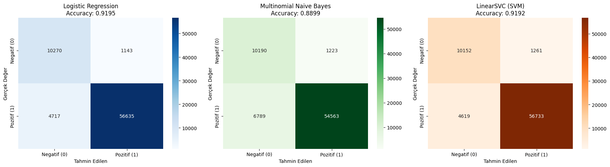
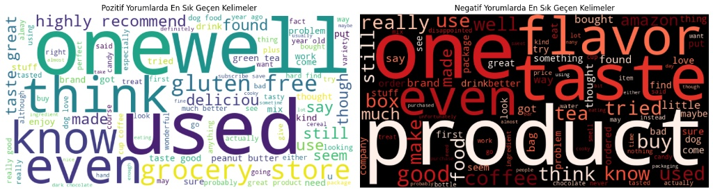

# Amazon Fine Food Reviews — Sentiment Analysis (NLP)

An end-to-end Natural Language Processing (NLP) pipeline developed to classify customer product reviews by sentiment on the [Amazon Fine Food Reviews](https://www.kaggle.com/datasets/snap/amazon-fine-food-reviews) dataset using classical machine learning models, TF-IDF feature extraction, and an interactive real-time inference widget.

## Technologies & Libraries
- **Language:** Python
- **NLP & Preprocessing:** NLTK (Tokenization, Negation-Aware Stopwords Removal, WordNet Lemmatization), Regex
- **Feature Extraction:** Scikit-learn (`TfidfVectorizer`)
- **Classification Models:** Logistic Regression, Multinomial Naive Bayes, Linear Support Vector Classification (`LinearSVC`)
- **Visualization & Interactive Testing:** Matplotlib, Seaborn, WordCloud, `ipywidgets`

## Project Workflow
1. **Text Cleaning & Preprocessing:** Stripped HTML tags, punctuation, and numbers; applied lowercasing, WordNet lemmatization, and negation-aware stopword filtering (preserving critical sentiment modifiers such as *not*, *no*, *never*, and *nor*).
2. **Feature Engineering (TF-IDF):** Converted normalized review text into numerical feature vectors using TF-IDF weighting (`max_features=20000`, `ngram_range=(1, 2)`).
3. **Model Training & Comparison:** Trained and benchmarked Logistic Regression, Multinomial Naive Bayes, and `LinearSVC` classifiers across Accuracy, Precision, Recall, and F1-Score metrics.
4. **Interactive Real-Time Inference:** Built a live testing interface using `ipywidgets` to predict sentiment on custom user-input reviews directly inside the notebook.

## Visual Results

### Confusion Matrix

### Word Cloud

